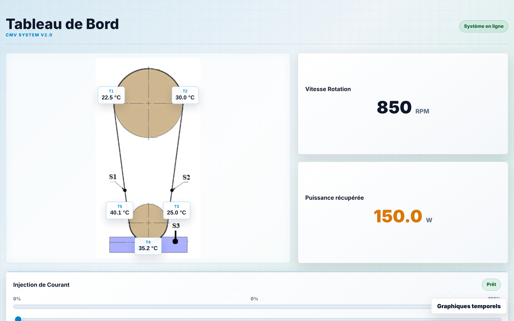
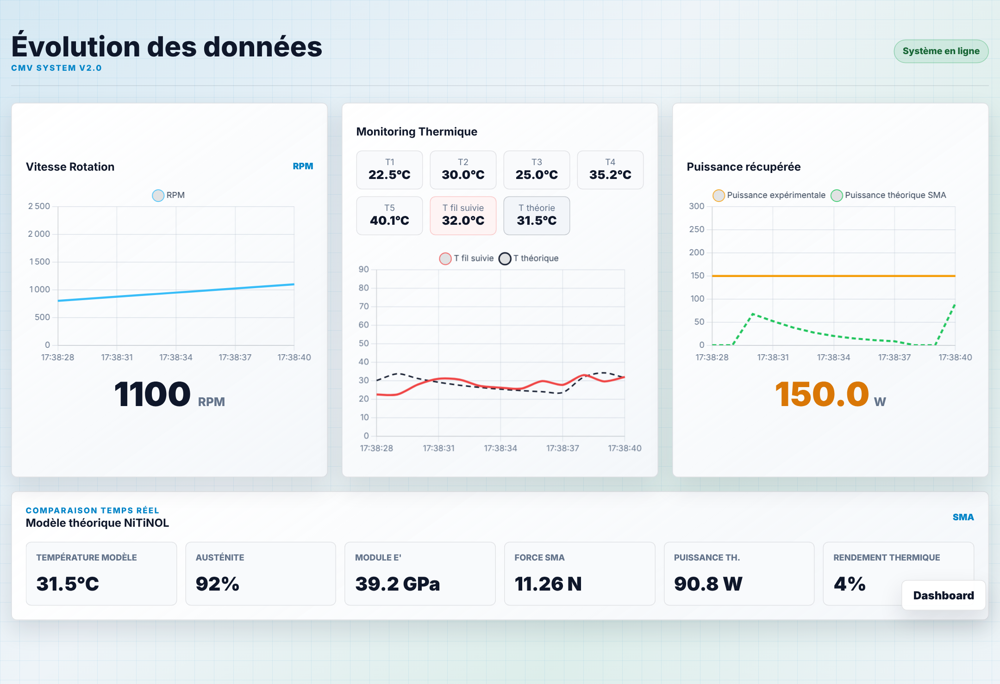

# Projet CMV — banc moteur à fil NiTiNOL

Instrumentation et IHM de supervision d'un **moteur thermique à alliage à mémoire de forme** (NiTiNOL) : une boucle de fil passe sur deux poulies, dont la poulie basse trempe dans un bain chaud. Le fil se rétracte en se réchauffant (transformation martensite → austénite), ce qui entraîne la rotation.

Le projet relie trois couches :

- **Firmware STM32 / FreeRTOS** : acquisition des températures et du capteur de rotation, commande PWM de l'injection de courant.
- **Liaison série** (UART 115 200 bauds) avec un protocole texte acquitté.
- **IHM de bureau Tauri v2** (Rust + JavaScript) : affichage temps réel, graphiques et comparaison avec un **modèle théorique du fil SMA**.



## Architecture

```text
 Capteurs (ADC, entrée impulsions)                     Opérateur
            │                                              ▲
            ▼                                              │
 ┌───────────────────────────┐   UART 115200   ┌───────────┴──────────────┐
 │ STM32 + FreeRTOS          │ ──────────────► │ Tauri (Rust)             │
 │  Task_CapteurTEMP  (ADC)  │  trames 30 Hz   │  thread lecteur série    │
 │  Task_CapteurVIT   (front)│                 │  état partagé Arc<Mutex> │
 │  Task_Envoie       (UART) │ ◄────────────── │  commande set_pwm        │
 │  defaultTask (PWM TIM3)   │   PWM;<duty>    └───────────┬──────────────┘
 └───────────────────────────┘                             │ invoke / events
                                                           ▼
                                               Interface web (Chart.js)
                                               + modèle théorique SMA
```

## Firmware (`firmware/main.c`)

- 4 tâches FreeRTOS (CMSIS-RTOS v1) avec priorités distinctes : acquisition température (haute), comptage d'impulsions (au-dessus de la normale), application du rapport cyclique, envoi série (idle).
- Horloge système 80 MHz (HSI + PLL), PWM sur TIM3 à **100 Hz** avec une résolution de 10 000 pas.
- Réception UART **par interruption**, octet par octet, avec tampon de ligne borné. Un débordement de ce tampon est signalé à l'IHM au lieu d'être ignoré silencieusement.
- Les acquittements et les erreurs sont émis depuis la tâche d'envoi, jamais depuis l'interruption.

Seul le code utilisateur est versionné : `main.c` provient d'un projet STM32CubeIDE (le fichier `.ioc`, `main.h` et les drivers HAL n'y figurent pas). Les parties générées par CubeMX restent sous licence STMicroelectronics.

## Protocole série

| Sens | Trame | Rôle |
| --- | --- | --- |
| STM32 → PC | `<impulsions>\|<T1>\|<T2>\|<duty>\r\n` | Mesures, environ 30 Hz |
| PC → STM32 | `PWM;<0..100>\n` | Consigne de rapport cyclique (bornée, arrondie à l'entier) |
| STM32 → PC | `ACK;PWM;<duty>;COMMANDE_RECUE\r\n` | Accusé de réception de la consigne |
| STM32 → PC | `ERR;PWM`, `ERR;CMD`, `ERR;OVERFLOW` | Valeur illisible, commande inconnue, ligne trop longue |

Le parsing côté Rust (nettoyage des octets nuls, filtrage des ACK et ERR, construction des commandes) est couvert par des tests unitaires.

## IHM (`src-tauri/`, `src/`)

- Détection automatique de la carte : port USB de VID `0x0483` (ST-LINK) sous Linux comme sous Windows, puis repli sur `/dev/ttyACM*` et `/dev/ttyUSB*`.
- Sans carte branchée, l'application passe en **mode simulation** pour développer l'interface sans le banc.
- Vue « Graphiques temporels » : régime, températures, puissance, et **modèle théorique NiTiNOL** calculé en temps réel. Le modèle couvre la fraction d'austénite, le module d'Young équivalent, la force, la puissance et le rendement thermique. Il s'appuie sur des échanges convectifs (nombre de Nusselt) dans l'eau et dans l'air.



*Captures réalisées en mode simulation : les valeurs affichées ne sont pas des mesures.*

## Lancer l'IHM

Prérequis : la toolchain Rust et les [prérequis Tauri v2](https://v2.tauri.app/start/prerequisites/). Sous Linux, l'accès au port série demande d'appartenir au groupe `dialout`.

```bash
npm install
npm run tauri dev        # lance l'IHM (mode simulation si aucune carte n'est détectée)
cd src-tauri && cargo test
```

## Limites connues

- La valeur affichée comme « RPM » est pour l'instant un **compteur cumulé d'impulsions**. La conversion en tours par minute (fenêtre temporelle, nombre d'impulsions par tour) reste à implémenter.
- Les températures T1 et T2 sont transmises en **valeurs ADC brutes** (`resolution_Temp = 1`) : la conversion en °C dépend de l'étalonnage des capteurs.
- Sur le banc réel, seules T1, T2 et le compteur sont transmis. T3 à T5 et la puissance récupérée ne sont alimentées qu'en mode simulation.
- Le comptage d'impulsions se fait par scrutation logicielle toutes les 3 ms, ce qui borne la fréquence mesurable. Une capture d'entrée timer serait plus robuste.

## Licence

Code de l'IHM sous licence [MIT](LICENSE). Pour les parties générées de `firmware/main.c`, voir l'en-tête du fichier.
